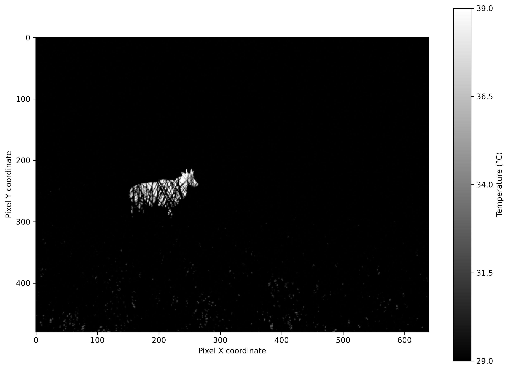

# Edge-Deployed Infrared (IR) Detection of Occluded Wildlife During Agricultural Harvesting

> **College Research Project** · Infrared Computer Vision · Synthetic Dataset Generation · Edge AI

[](https://github.com/ultralytics/ultralytics)
[](https://www.blender.org/)
[](https://www.python.org/)
[]()

---

## 🔍 Problem Statement

During mechanical harvesting of crops in India, large animals hide and rest within tall crop fields. They become invisible to harvesting machine operators, leading to fatal animal-machine collisions and injuries to farmers.

**Our Project** proposes an **infrared thermal imaging system** mounted on harvesting equipment that detects occluded wildlife in real-time using a lightweight object detection model deployable on edge hardware.

---

## 🧪 This Repository — Proof of Concept (100-Image Test)

> ⚠️ **This is a small-scale proof-of-concept run.** The full project uses a much larger dataset. This repo validates the pipeline end-to-end: synthetic data generation → annotation → YOLO training → inference.

| Item | Detail |
|---|---|
| **Target Animal** | Nilgai (Indian Antelope) |
| **Sensor Modality** | Simulated Thermal IR (White-Hot palette) |
| **Dataset Size** | 100 synthetic images |
| **Train / Val Split** | 80 / 20 |
| **Model** | YOLOv8 Nano (`yolov8n.pt`) |
| **Resolution** | 640 × 480 px |
| **Ambient Temperature (Ta)** | 27.0 °C (Ahmedabad morning) |
| **Image Format** | PNG |

---

## 🎨 Synthetic Dataset Pipeline (Blender)

Since real annotated thermal IR images of occluded Nilgai are virtually nonexistent, we **built our own synthetic dataset entirely in Blender**.

The pipeline is a two-script system:

### Step 1 — Scene Setup 
Sets up the 3D Blender scene before dataset generation:
- Places and scales the **Nilgai 3D mesh** (`mesh_0`) in a field environment
- Creates a **10×10 grass grid** on a soil ground plane
- Configures a **fixed overhead-angle thermal camera** (640×480, EEVEE renderer)
- Assigns natural-look preview materials (not used for training data)
- Sets up sun lighting for realistic shadow casting

### Step 2 — Dataset Generator 
Generates the actual training data across 100 randomized frames:

```
For each frame (0 → 99):
  1. Randomize Nilgai position (±1.5m X/Y) and rotation (0–360°)
  2. Render SILHOUETTE MASK → Extract pixel-accurate YOLO bounding box
  3. Render WHITE-HOT thermal image  → saved to white_hot/
  4. Render IRONBOW RGB image        → saved to ironbow_rgb/
  5. Convert Ironbow RGB → HSV       → saved to ironbow_hsv/
  6. Save YOLO label (.txt)          → saved to labels/
```

#### 🌡️ Physically Grounded Temperature Mapping
Rather than arbitrary pixel colors, temperatures are derived from a **physics-informed model** relative to ambient air temperature (`Ta`):

| Object | Temperature |
|---|---|
| Nilgai (mammal) | Ta + 12.0 °C = **39.0 °C** |
| Soil | Ta + 3.0 °C = **30.0 °C** |
| Grass | Ta + 2.0 °C = **29.0 °C** |
| Sky | Capped at **−40 °C** (cold sink) |

These temperatures are mapped to a **dynamic greyscale window** (percentile normalization, sky excluded) to produce realistic contrast in the White-Hot palette.

#### 📦 Output Format per Frame
```
yolo_ds_ta=27.0/
├── white_hot/          ← Greyscale thermal render (training input)
├── ironbow_rgb/        ← False-color Ironbow palette render
├── ironbow_hsv/        ← HSV-converted Ironbow (alternative input)
└── labels/             ← YOLO format: class cx cy w h (normalized)
```

---

## 📁 Repository Structure

```
thermal_ir/
│
├── yolo_ds_ta=27.0/                       # Raw Blender output (100 frames)
│   ├── white_hot/                         # White-hot thermal renders (100 images)
│   ├── ironbow_rgb/                       # Ironbow false-color renders
│   ├── ironbow_hsv/                       # HSV-converted ironbow images
│   ├── labels/                            # Auto-generated YOLO labels
│   └── white_hot_frame_0000_with_colorbar.png  # Sample annotated viz
│
├── white_hot_yolo_ds_blender/             # Processed YOLO dataset (train/val split)
│   ├── dataset.yaml                       # YOLO dataset config (1 class: nilgai)
│   ├── images/
│   │   ├── train/                         # 80 training images
│   │   └── val/                           # 20 validation images
│   └── labels/                            # Corresponding YOLO label files
│
├── yolov8n.pt                             # YOLOv8 Nano pretrained weights
├── yolo_100img_test.ipynb                 # Training + evaluation notebook
└── Edge_Deployed_Infrared_(IR)
```

---

## 🚀 Running the Proof of Concept

### Prerequisites
```bash
pip install ultralytics opencv-python matplotlib
```
> Blender 4.x required for dataset generation scripts.

### Training
Open and run `yolo_100img_test.ipynb`. The notebook covers:
1. Dataset loading & sanity-check visualization
2. YOLOv8n fine-tuning on the 100-image White-Hot dataset
3. Validation metrics (mAP, precision, recall)
4. Inference on sample frames with bounding-box overlays

### Regenerating the Dataset (Blender)
1. Open your Nilgai scene in Blender
2. Run `blender_ui.py` in the Blender scripting workspace (scene setup)
3. Run `blender_ds .py` to render 100 frames and auto-generate labels

---

## 📊 Dataset Sample

Below is a sample White-Hot thermal render with the temperature colorbar. The Nilgai body heat (~39 °C) appears brighter than the surrounding grass/soil, making it detectable even when geometrically occluded by grass blades.

> *Frame 0000 — Nilgai visible through grass occlusion, White-Hot palette, Ta = 27°C*



---

## 💡 Key Technical Decisions

| Decision | Rationale |
|---|---|
| **Synthetic data via Blender** | No annotated real-world IR dataset for Nilgai exists publicly |
| **White-Hot palette for training** | Maximum luminance contrast between mammal and background |
| **Temperature-relative color mapping** | Physically realistic; generalizes across different ambient temps |
| **Dynamic greyscale window (sky excluded)** | Prevents cold sky from compressing the useful temperature range |
| **Silhouette mask render for BBox** | Pixel-accurate labels instead of manual or approximated boxes |
| **YOLOv8 Nano** | Optimized for edge deployment (Raspberry Pi / Jetson Nano class) |

---

## 🗺️ Project Roadmap

- [x] Blender pipeline for synthetic IR dataset generation
- [x] Physics-informed temperature-to-pixel mapping
- [x] Automated YOLO bounding box extraction via silhouette mask
- [x] 100-image proof-of-concept training run (White-Hot, YOLOv8n)
- [ ] Scale to 5,000+ image dataset across multiple ambient temperatures
- [ ] Multi-species support (deer, wild boar)
- [ ] Edge deployment on Jetson Nano / Raspberry Pi + FLIR Lepton
- [ ] Real-world IR image validation

---
## 👥 About

This is an ongoing undergraduate research project exploring the intersection of **computer vision**, **thermal infrared sensing**, and **edge AI** for agricultural safety in India.

---

*Made with Blender · YOLOv8 · Python*
